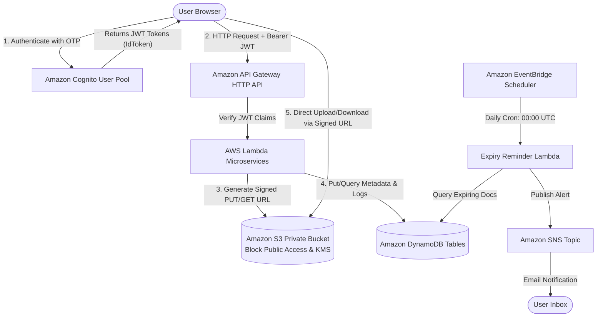

# 🛡️ Secure Digital Document Vault
### Cloud-Native AWS Serverless & DevOps Major Project (BTech CSE)

A functional, secure, cloud-native web application designed to securely upload, store, organize, share, and track digital credentials (educational certificates, passports, licenses, transcripts).

Built with **Amazon Cognito**, **Amazon S3 (Private & Encrypted)**, **Amazon DynamoDB**, **AWS Lambda**, **Amazon API Gateway**, **Amazon EventBridge Scheduler**, **Amazon SNS**, **Terraform (IaC)**, and **GitHub Actions (CI/CD)**.

---

## 🏛️ System Architecture



---

## 🚀 Key Features

1. **Cognito Identity Authentication**: Secure user registration, password enforcement, email OTP confirmation, and JWT claims verification.
2. **Zero-Trust Private S3 Storage**: S3 Block Public Access enabled across all 4 parameters. Files are encrypted at rest with Server-Side Encryption (`AES256`/KMS).
3. **Direct-to-S3 Pre-Signed Uploads**: Browser transfers binary payloads directly to S3 via temporary pre-signed PUT URLs. Eliminates memory bottlenecks on backend servers.
4. **Revocable Time-Limited Sharing**: Solves the core limitation of standard pre-signed URLs by wrapping shares in a database-backed token with instant owner revocation controls.
5. **Automated Expiry Alerts**: EventBridge scans for documents expiring within 30, 15, or 7 days and dispatches alerts via Amazon SNS without duplicate notification spam.
6. **Security Audit Trails**: Comprehensive logging of uploads, downloads, link generations, and unauthorized access attempts in DynamoDB.
7. **Infrastructure as Code (Terraform)**: The entire AWS infrastructure is codified in clean, modular Terraform templates.
8. **DevOps CI/CD (GitHub Actions)**: Automated unit testing and continuous deployment using AWS OIDC authentication (zero static secret keys).

---

## 📦 Project Structure

```text
secure-doc-vault/
├── frontend/                  # Responsive HTML5, CSS3, ES Modules
│   ├── css/                  # Modern UI styles & dashboard layout
│   ├── js/                   # Auth, API client, Dashboard controller
│   ├── index.html            # Landing page & authentication gateway
│   ├── dashboard.html        # Main authenticated vault manager
│   ├── shared.html           # Public recipient link viewer
│   └── activity.html         # Tamper-evident security audit history
├── backend/                   # Serverless Lambda Microservices (Node.js 20)
│   ├── src/documents/        # getUploadUrl, listDocuments, getDownloadUrl, deleteDocument
│   ├── src/sharing/          # createShareLink, accessSharedDoc, revokeShareLink
│   ├── src/notifications/    # expiryChecker (EventBridge daily handler)
│   ├── src/shared/           # S3, DynamoDB, and Audit Logger helpers
│   └── tests/                # Unit tests for MIME validation & expiry logic
├── terraform/                 # Infrastructure as Code
│   ├── s3.tf                 # Private bucket, CORS, SSE
│   ├── dynamodb.tf           # Tables: Documents, Shares, ActivityLogs
│   ├── cognito.tf            # User Pool, App Client, Verification Email
│   ├── lambda.tf             # IAM roles & microservices deployment
│   ├── apigateway.tf         # HTTP API, JWT authorizer, integrations
│   └── eventbridge.tf        # Daily cron schedule & SNS alerts
├── .github/workflows/         # CI/CD Workflows (test.yml, deploy.yml)
└── docs/                      # Viva Questions, Database Schemas, Security Models
```

---

## ⚡ Quick Start: Running & Demonstrating Locally (Phase 1 & 2)

The project includes an **out-of-the-box Interactive Demo Mode** that allows you to preview, test, and demonstrate all vault workflows right in your browser immediately:

1. Open PowerShell and navigate to the project root:
   ```powershell
   cd C:\Users\Mustak\.gemini\antigravity\scratch\secure-doc-vault
   ```

2. Run the automated backend test suite:
   ```powershell
   cd backend
   node --test tests/documents.test.js
   cd ..
   ```

3. Launch the local web server to test the frontend:
   ```powershell
   # Using Python 3's built-in webserver:
   python -m http.server 8000 --directory frontend
   # Or using Node npx:
   # npx.cmd serve frontend -l 8000
   ```
4. Open your browser and visit:
   ```text
   http://localhost:8000/index.html
   ```
5. Click **"Sign In"** (or use any email like `student@university.edu` and password). You will enter the dashboard with pre-loaded mock credentials, where you can:
   - Upload new documents (with automatic MIME validation and size checks).
   - Generate revocable time-limited sharing links and test them in `shared.html`.
   - Inspect the real-time **Security Activity History** in `activity.html`.

---

## ☁️ Deploying to AWS via Terraform (Phases 3–9)

When you are ready to provision your live AWS cloud infrastructure:

### Step 1: Configure AWS Credentials
Ensure your AWS CLI has active credentials configured:
```powershell
aws configure
```

### Step 2: Initialize & Apply Terraform
Navigate to the `terraform/` directory:
```powershell
cd C:\Users\Mustak\.gemini\antigravity\scratch\secure-doc-vault\terraform

# Initialize Terraform providers
terraform init

# Validate configuration
terraform validate

# Review proposed resources
terraform plan

# Deploy infrastructure to AWS (takes ~2 minutes)
terraform apply -auto-approve
```

### Step 3: Connect Frontend to Your Live Cloud Resources
Terraform will display outputs:
- `cognito_user_pool_id`
- `cognito_client_id`
- `api_gateway_endpoint`

Copy these values into `frontend/js/config.js`:
```javascript
export const CONFIG = {
  awsRegion: 'ap-south-1', // Your chosen region
  cognito: {
    userPoolId: '<your-cognito-user-pool-id>',
    clientId: '<your-cognito-client-id>',
  },
  apiBaseUrl: '<your-api-gateway-endpoint>',
  enableDemoMode: false, // Switch to false for live AWS production!
};
```

---

## 🧪 Comprehensive Test Plan

| Test ID | Test Scenario | Steps | Expected Result |
|---|---|---|---|
| **TC-01** | User Registration | Submit email & password | Verification code dispatched to email; user remains unconfirmed until OTP validated. |
| **TC-02** | Unauthorized Dashboard Access | Access `dashboard.html` without JWT | Interceptor redirects user to `index.html`. |
| **TC-03** | Secure Upload | Upload a valid PDF file (<10MB) | Generates pre-signed S3 PUT URL; file saved in private S3 bucket; metadata stored in DynamoDB. |
| **TC-04** | File Type Validation | Attempt to upload `.exe` or `.sh` script | Backend rejects upload with HTTP 400 "File type not permitted". |
| **TC-05** | Ownership Authorization (IDOR) | User A attempts to download User B's `docId` | Lambda verifies `userId` partition key; returns HTTP 404/403 and records audit event. |
| **TC-06** | Share Link Expiration | Generate 15-minute share link and check after expiry | Public resolver returns HTTP 410 "This sharing link has expired". |
| **TC-07** | Manual Link Revocation | Owner clicks "Revoke Share" | DynamoDB sets `isRevoked: true`; subsequent access attempts are immediately blocked. |
| **TC-08** | Expiry Reminder Cron | EventBridge invokes `expiryChecker` | Identifies documents expiring in ≤30 days and publishes SNS alert message. |

---

## 💰 Cost Breakdown (AWS Free Tier Compliance)

- **Cognito**: 50,000 monthly active users (Permanently Free).
- **Lambda**: 1,000,000 invocations / month (Permanently Free).
- **DynamoDB**: 25 GB storage & 25 RCU/WCU (Permanently Free).
- **S3**: 5 GB standard storage (12 Months Free).
- **API Gateway**: 1,000,000 requests / month (12 Months Free).
- **SNS**: 1,000 email dispatches / month (Permanently Free).

> **Estimated Monthly Cost**: **$0.00** for typical academic usage and demonstrations.

---

## 🧹 Infrastructure Teardown (Clean-Up)

To avoid any unexpected charges after your college presentation:
```powershell
cd C:\Users\Mustak\.gemini\antigravity\scratch\secure-doc-vault\terraform
terraform destroy -auto-approve
```
